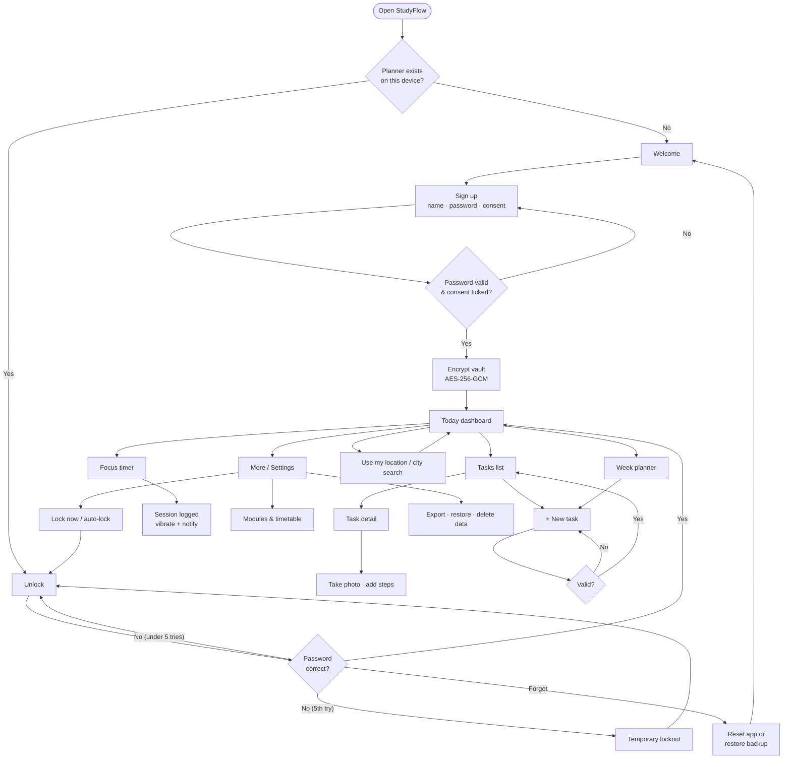
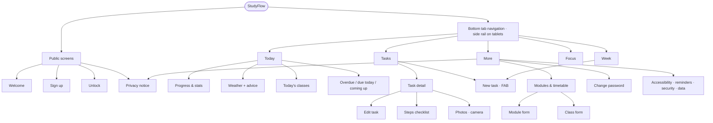

# StudyFlow – Design Proposal Summary

This follows the structure from the *Design Proposal – User Flow & App Map* lab.

## 1. App concept and MVP

**Problem:** students juggle deadlines across several modules, a changing timetable and Scottish weather. Many get caught out by overlapping submissions and lose focus while studying. General to-do apps don't know about modules or classes, and many sync personal data to the cloud.

**Concept:** a calm, offline-first planner that puts *what's due*, *where I need to be* and *what the weather is doing* on one screen, and helps students start focused work.

**MVP (minimum viable product):**
1. Create, edit, complete and delete tasks with module, type, due date/time, priority, notes and steps.
2. Modules with colours, plus a weekly timetable of classes.
3. A Today dashboard: progress, overdue, due today, coming up and today's classes.
4. A Week planner combining classes, deadlines, bank holidays and the forecast.
5. A focus (Pomodoro) timer that logs study minutes.
6. Secure local sign-up and unlock with encrypted storage that works offline.

**Beyond the MVP:** calendar (.ics) import from the student portal and export to Google/Outlook, camera photos on tasks, deadline notifications, GPS weather and advice, city search, encrypted backup/restore, accessibility settings, and installation as an app.

## 2. User personas

**Aisha, 22, MSc Computing (international student).** She works 15 hours a week in a café, juggles four modules and often forgets which lab is in which room. *Goals:* see everything due this week at a glance and never miss a submission. *Frustrations:* deadlines scattered across emails and MyDundee, and unreliable campus Wi-Fi. *Needs:* offline access, reminders and a week view.

**Callum, 19, 2nd-year BSc, dyslexic.** He finds dense interfaces tiring and procrastinates on big assignments. *Goals:* break work into small steps and keep focus. *Frustrations:* small text and cluttered apps. *Needs:* adjustable text size, high contrast, steps checklist and a focus timer.

**Priya, 27, part-time mature student and parent.** She studies in short bursts on her phone and is privacy-conscious. *Goals:* quick capture (photograph the assignment brief) and no account or tracking. *Needs:* camera capture, encryption and data she controls (export/delete).

## 3. Hardware and sensor research (Week 2 lecture)

| Sensor / hardware | Used? | How |
|---|---|---|
| GPS | ✅ | Local forecast for commute/class advice. Coordinates are rounded to 2 decimal places (~1 km) for privacy. |
| Camera | ✅ | Photograph assignment briefs, whiteboards and slides. Uses `capture="environment"` (rear camera) and offers a gallery fallback. |
| Vibration motor (haptics) | ✅ | Feedback when you complete tasks, end a session or make a mistake. Can be switched off. |
| Touchscreen gestures | ✅ | Swipe left/right to change week; 48 px targets. |
| Screen / power (Wake Lock) | ✅ | Keeps the screen on during focus sessions, released afterwards to save battery. |
| Notifications / badge | ✅ | Reminders 24 h before a deadline; app-icon badge for tasks overdue or due today. |
| Accelerometer / gyroscope | ❌ | Considered for "flip phone to start focus", but rejected: limited iOS PWA support and a permission prompt that adds little value. |
| Biometrics (WebAuthn) | ❌ (future) | Fingerprint/Face unlock is planned for a later version (see Reflection). |

## 4. APIs

| API | Purpose | Notes |
|---|---|---|
| Open-Meteo Forecast | Current weather + 7-day forecast and rain chance → advice and Week planner icons | Free, no API key, CORS-enabled. Cached for 30 min and available offline. |
| Open-Meteo Geocoding | "Change city" search (the manual alternative to GPS, as in the weather lab) | Called only when the user searches |
| GOV.UK Bank Holidays | UK bank holidays by region (default Scotland) | Cached for 7 days |
| iCalendar (.ics, RFC 5545) | Import timetable and deadlines exported from the student portal, Blackboard, Outlook or Google; export deadlines back | Parsed on the device (js/ics.js) – nothing is uploaded |
| Web platform APIs | Geolocation, Web Crypto, IndexedDB, Service Worker, Cache, Notifications, Vibration, Wake Lock, Web Share, Badging | No third-party SDKs |

## 5. Wireframes and screens

Screens were designed mobile-first and refined through the E2E screenshots (run `npm run test:e2e` to regenerate them in `screenshots/`).

## 6. User flow

Key journeys:
- **New user:** Welcome → Sign up (password, consent, optional sample data) → Today.
- **Returning user:** Unlock → Today (or straight back to the screen they were on) → feature → Lock / auto-lock.
- **Add a deadline:** any tab → **+** → form (validated) → back to list → *View* toast.
- **Capture a brief:** Task → Take photo → compressed and encrypted → thumbnail.

## 7. App map

Navigation patterns (from the lab): **tab navigation** for the five main sections, and **stack navigation** for detail and form screens, each with a back button. Settings live in **More** rather than a drawer, so everything stays one thumb-tap away.

## 8. Design principles applied (Week 2 lecture)

- **Navigation & structure:** a common bottom navigation pattern. Adding a task takes three steps (+ → title → Add) because the other fields have sensible defaults.
- **Touch-friendly:** every control is at least 48×48 px (Google) / 44×44 px (Apple), with spacing between targets.
- **Visual hierarchy & readability:** large headings, a progress ring, short text, and colour plus text for priority and urgency (e.g. "Overdue by 1 day" in red *and* words).
- **Feedback & interaction:** toasts with Undo, spinners while the key is derived, skeleton loaders for the weather, vibration, and inline form errors.
- **Platform conventions:** Material-style FAB and cards on Android; iOS-style blurred bars, Safari install instructions and safe-area insets.
- **Consistency:** one design system (CSS custom properties) across every screen and theme.

## 9. Technology choice

The module guide recommends a **PWA** (HTML/CSS/JS) because it is simple, cross-platform and well documented. Native (Kotlin/Swift) would give deeper hardware access but needs two codebases. React Native/Flutter were rejected because the app needs no advanced native features, and a framework would add build tooling and bundle size. Plain ES modules keep the app small (~200 KB) and fast, and make every line explainable in the demo.
